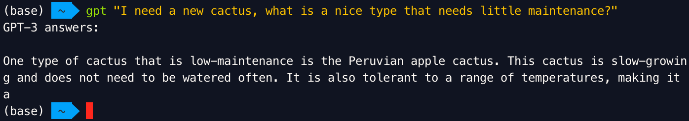

Using my friend ChatGPT I made a little CLI to talk to… GPT. It’s basically a bash script that you can place in one of you `bin` folders and execute from wherever in your terminal:

```bash
gpt "I need a new cactus, what is a nice type that needs little maintenance?"
```

After which GPT will answer you with (hopefully) a nice answer:

```shell
GPT-3 answers:

One type of cactus that is low-maintenance is the Peruvian apple cactus. This cactus is slow-growing and does not need to be watered often. It is also tolerant to a range of temperatures, making it a
```

## Script

```bash
#!/bin/bash

function print_help() {
    GREEN="\033[1;32m"
    BLUE="\033[1;34m"
    RESET="\033[0m"

    echo -e "${GREEN}Usage:${RESET}"
    echo -e "  ${BLUE}gpt [options] [question]${RESET}"
    echo ""
    echo -e "${GREEN}Options:${RESET}"
    echo -e "  ${BLUE}-h, --help${RESET}        Show this help message and exit"
    echo -e "  ${BLUE}--t=NUM${RESET}           Set the maximum number of tokens in the response (default: 50)"
    echo ""
    echo -e "${GREEN}Examples:${RESET}"
    echo -e "  ${BLUE}gpt --t=200 Tell me a story about a programmer who became a potato${RESET}"
    echo -e "  ${BLUE}gpt --t=100 \"How can I make my computer run faster with a rubber chicken?\"${RESET}"
    echo -e "  ${BLUE}gpt What would a conversation between a cat and a toaster sound like --t=20${RESET}"
}

if [[ -z "$OPENAI_API_KEY" ]]; then
    echo "Please set the OPENAI_API_KEY environment variable."
    exit 1
fi

# Set default max_tokens
max_tokens=50

# Parse command-line arguments
for i in "$@"
do
case $i in
    -h|--help)
    print_help
    exit 0
    ;;
    --t=*)
    max_tokens="${i#*=}"
    shift
    ;;
    *)
    if [[ -z "$QUESTION" ]]; then
        QUESTION="$i"
    else
        QUESTION="$QUESTION $i"
    fi
    shift
    ;;
esac
done

# Prompt for question and max_tokens if not provided
if [[ -z "$QUESTION" ]]; then
    echo "Please enter your question:"
    read -r QUESTION
fi

if [[ -z "$max_tokens" ]]; then
    echo "Please enter the max tokens (default: 50):"
    read -r max_tokens_input
    if [[ ! -z "$max_tokens_input" ]]; then
        max_tokens="$max_tokens_input"
    fi
fi

response=$(curl -s -X POST "https://api.openai.com/v1/engines/text-davinci-002/completions" \
  -H "Content-Type: application/json" \
  -H "Authorization: Bearer $OPENAI_API_KEY" \
  -d "{\"prompt\": \"${QUESTION}\", \"max_tokens\": ${max_tokens}, \"n\": 1, \"stop\": null, \"temperature\": 0.7}")

error_message=$(echo "$response" | jq -r '.error.message' 2>/dev/null)

if [[ "$error_message" != "null" ]] && [[ ! -z "$error_message" ]]; then
    echo "Error: $error_message"
else
    answer=$(echo "$response" | jq -r '.choices[0].text' | sed 's/^[[:space:]]*//')
    echo "GPT-3 answers: $answer"
fi
```

## How to use

1.  First, we need to make sure `jq` is installed. `jq` is a light-weight command-line JSON processor used by this script to parse the response from the OpenAI API endpoint.

```shell
# For Ubuntu/Debian
sudo apt-get install jq

# For macOS (using Homebrew)
brew install jq
```

Then, let’s create the folder in which we will put the script later on.

1.  Open a terminal window.
2.  Create a `bin` directory in the user’s home directory, if it doesn’t already exist:

```shell
mkdir -p ~/bin
```

1.  Change to the newly created `bin` directory:

```shell
cd ~/bin
```

We will now create the script.

1.  Create a new file called `gpt` using a text editor (e.g., `nano`, `vim`, or `code`). Copy and paste the provided script into the file:

```shell
vi gpt
```

To able to execute the script later on, we need to give it executive permissions.

1.  Save the file and exit the text editor.
2.  Set the script to be executable:

```shell
chmod +x gpt
```

We will now add the bin directory to the PATH environment, allowing us to call the script from any location.

1.  Add the `~/bin` directory to the PATH environment variable. For `bash`, add the following line to the end of the `~/.bashrc` or `~/.bash_profile` file:

```shell
export PATH="$HOME/bin:$PATH"
```

For `zsh`, add the following line to the end of the `~/.zshrc` file:

```shell
export PATH="$HOME/bin:$PATH"
```

1.  Source the appropriate shell configuration file to apply the changes:

For `bash`:

```shell
source ~/.bashrc
# Or, if using macOS:
source ~/.bash_profile
```

For `zsh`:

```shell
source ~/.zshrc
```

1.  Set the OpenAI API key as an environment variable by adding the following line to the same shell configuration file used in step 7:

```shell
export OPENAI_API_KEY="your-api-key"
```

Replace `your-api-key` with the actual API key.

1.  Source the shell configuration file again (as shown in step 9) to apply the new environment variable.

Now the `gpt` script should be ready to use from anywhere in the terminal. Type `gpt` followed by a question or use the `-h` flag to display the help message.

## See also

[https://gist.github.com/drikusroor/ecf7d98cc6e67e8d9408828be87af3ca](https://gist.github.com/drikusroor/ecf7d98cc6e67e8d9408828be87af3ca) (Github gist)
